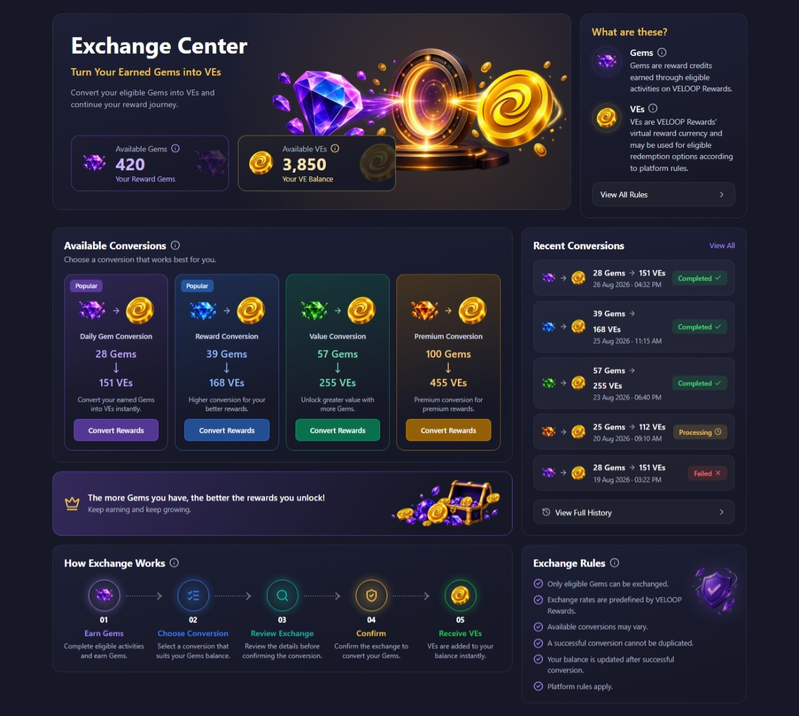
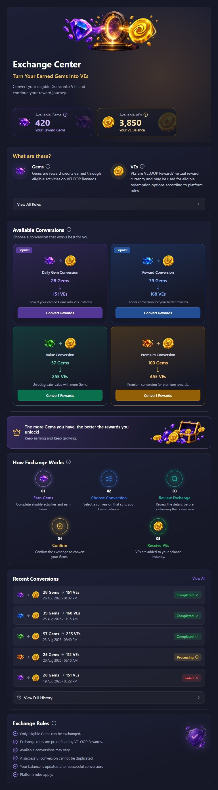
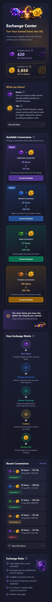
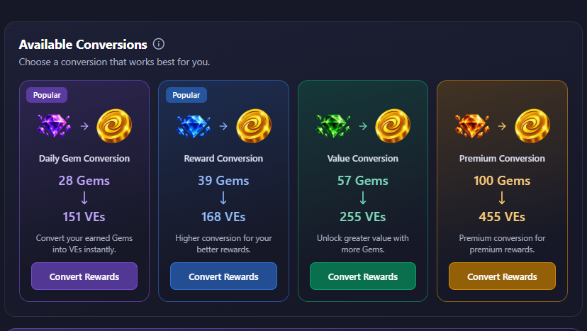
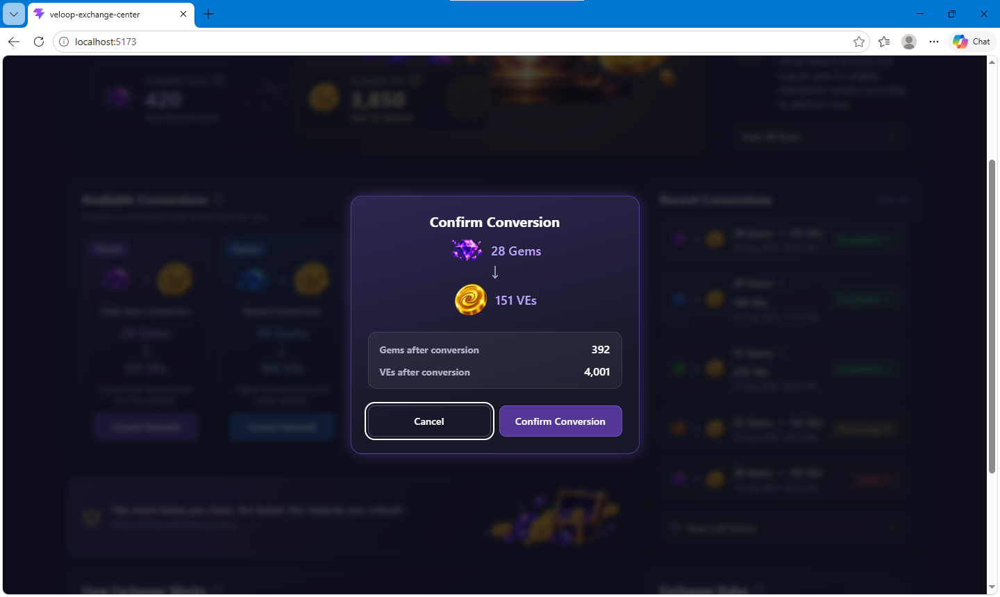
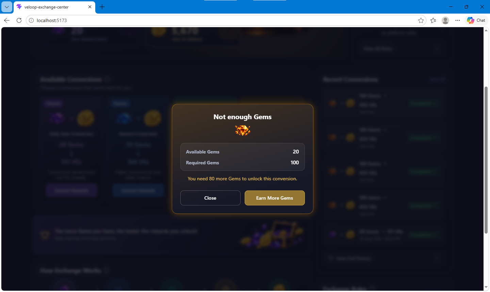
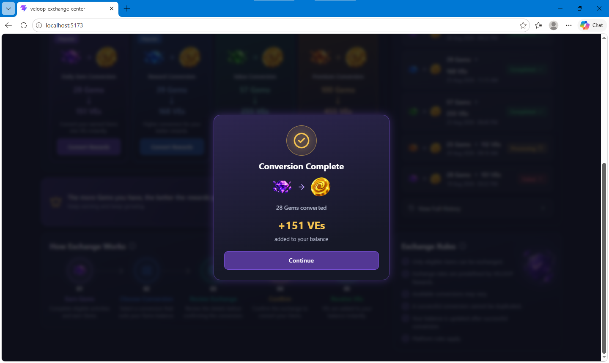
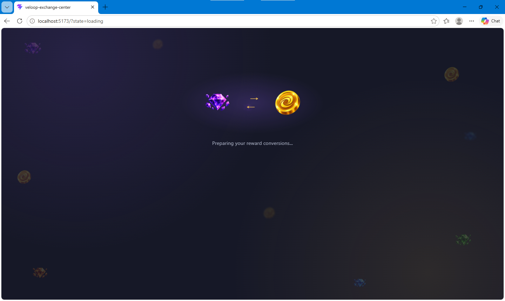
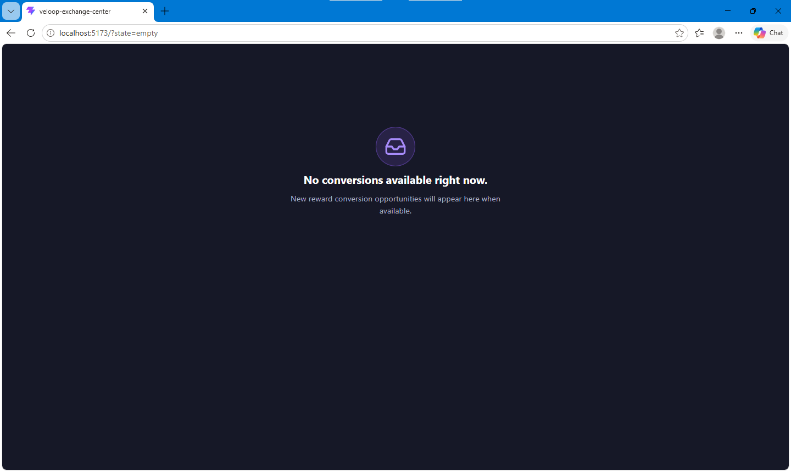
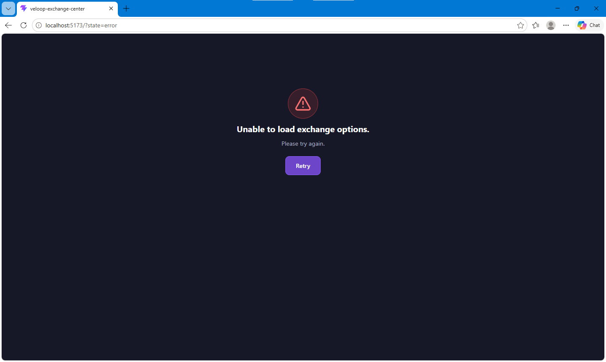

# VELOOP Rewards: Exchange Center

A complete frontend redesign of the VELOOP Rewards **Exchange Center**, where users convert earned **Gems** into **VEs** through predefined reward conversions.

The page is designed as a **Reward Conversion Center**: premium, fintech-inspired, reward-focused and easy to understand for first-time users. It is **not** a crypto swap, trading screen or DeFi dashboard, and it deliberately avoids that visual and verbal language.

> **Live Demo:** [https://veloop-exchange-center-rho.vercel.app/](https://veloop-exchange-center-rho.vercel.app/)
>
> **Repository:** [https://github.com/sadiksaifi9958/veloop-exchange-center](https://github.com/sadiksaifi9958/veloop-exchange-center)

---

## Table of Contents

1. [Project Overview](#project-overview)
2. [Exchange Center Concept](#exchange-center-concept)
3. [Screenshots](#screenshots)
4. [Features](#features)
5. [Exchange Logic](#exchange-logic)
6. [User Flow](#user-flow)
7. [Page States](#page-states)
8. [Components](#components)
9. [Project Structure](#project-structure)
10. [Technology Stack](#technology-stack)
11. [Installation](#installation)
12. [Local Development](#local-development)
13. [Build Instructions](#build-instructions)
14. [Responsive Design](#responsive-design)
15. [Animation System](#animation-system)
16. [Accessibility](#accessibility)
17. [Future Backend Integration](#future-backend-integration)
18. [Deployment](#deployment)
19. [Known Limitations](#known-limitations)

---

## Project Overview

The Exchange Center lets a user turn their earned Gems into VEs. This project redesigns the presentation layer completely (layout, cards, typography, visual hierarchy, illustrations, animations and interactions) while **preserving the existing business logic**:

- Gems to VEs conversion
- Existing exchange rates
- Existing eligibility and availability behaviour

The reference screenshot supplied with the assignment was used only to understand the functionality. The interface is an original design and does not copy the existing UI.

The application is frontend-only and runs on dummy data, but it is structured so a backend can be connected with minimal changes (see [Future Backend Integration](#future-backend-integration)).

## Exchange Center Concept

The design is built around a **Reward Conversion Vault** idea:

- A hero with a Gem to portal to VE illustration communicates the idea of conversion at first glance.
- Each conversion is a themed reward card (purple, blue, green, orange) rather than a swap form.
- Language stays in the reward world: _Conversion_, _Required Gems_, _You receive_, _Exchange value_. Terms such as market price, trading, buy/sell, profit or ROI are intentionally not used.
- A dark navy surface (`#161827`) with gold, soft blue and controlled purple accents keeps the page premium and consistent with VELOOP Rewards.

What a user should understand immediately:

| Question             | Answer shown on the page                             |
| -------------------- | ---------------------------------------------------- |
| What can I exchange? | Gems                                                 |
| What will I receive? | VEs                                                  |
| How does it work?    | Choose a conversion, review it, confirm, receive VEs |

## Screenshots

| View                  | Preview                                                   |
| --------------------- | --------------------------------------------------------- |
| Desktop               |                |
| Tablet                |                  |
| Mobile                |                  |
| Exchange cards        |            |
| Confirmation modal    |        |
| Insufficient Gems     |  |
| Successful conversion |   |
| Loading state         |           |
| Empty state           |               |
| Error state           |               |

## Features

**Core experience**

- Balance overview for Gems and VEs with animated count-up
- Four conversion cards with theme colours, gem illustration, required Gems and VEs received
- When the balance is too low, a card switches its action to _Earn More Gems_ and shows how many more Gems are needed
- Confirmation modal showing the conversion and the balance **after** conversion
- Insufficient Gems state with the exact number of missing Gems and an _Earn More Gems_ action
- Premium success popup with a small reward burst
- Processing state ("Converting...") that prevents double conversion
- Balance and Recent Conversions update after a successful conversion

**Guidance and trust**

- Information (ⓘ) tooltips for Gems, VEs, exchange rate and exchange rules
- "What are these?" explainer panel
- "How Exchange Works" five-step visual
- Exchange Rules section
- Recent Conversions with Completed, Processing and Failed statuses (icon plus text, never colour alone)

**Polish**

- Themed loader, empty state and error state with retry
- Reward banner and entrance animations
- Fully responsive from 320px to 1920px and beyond
- Respects the user's reduced-motion preference

## Exchange Logic

All exchange values live in a single data file, `src/data/exchangeData.js`. No exchange values are written inside JSX.

| ID            | Conversion           | Required Gems | VEs received | Theme  |
| ------------- | -------------------- | ------------- | ------------ | ------ |
| `exchange-01` | Daily Gem Conversion | 28            | 151          | Purple |
| `exchange-02` | Reward Conversion    | 39            | 168          | Blue   |
| `exchange-03` | Value Conversion     | 57            | 255          | Green  |
| `exchange-04` | Premium Conversion   | 100           | 455          | Orange |

Rules implemented in the UI:

1. A conversion is available only if `balance.gems >= requiredGems`.
2. If not, the card and the modal show the missing amount (`requiredGems - balance.gems`) and the call to action changes to **Earn More Gems**.
3. The confirmation modal previews the result: `gems - requiredGems` and `ves + receiveVEs`.
4. On success, the balance is updated once, a new item is added to the top of Recent Conversions, and the list keeps the latest five entries.
5. A conversion cannot be submitted twice while processing (see [User Flow](#user-flow)).

Dummy starting balance: **420 Gems** and **3,850 VEs**.

## User Flow

```
Choose a conversion
        |
        v
Review in confirmation modal
  |- not enough Gems -> insufficient state (Close / Earn More Gems)
  v
Confirm Conversion
        |
        v
"Converting..." (buttons disabled, Esc and outside click blocked)
        |
        v
Conversion Complete popup
        |
        v
Continue -> balance counts up, new row appears in Recent Conversions
```

Double-conversion protection:

- While processing, Cancel and Confirm are disabled, and Esc and overlay click are ignored.
- On the success popup, a presence check blocks repeated **Continue**, Esc or overlay clicks during the exit animation, so the balance can only change once.

## Page States

The page renders one of four states, controlled by `pageStatus` in `App.jsx`:

| State     | What the user sees                                                   |
| --------- | -------------------------------------------------------------------- |
| `loading` | Themed VELOOP loader with "Preparing your reward conversions..."     |
| `error`   | Friendly message with a **Retry** button (no technical errors shown) |
| `empty`   | "No conversions available right now." message                        |
| `ready`   | Full Exchange Center                                                 |

For design review and screenshots, a state can be forced through the URL:

```
/?state=loading
/?state=error
/?state=empty
```

## Components

All exchange components are in `src/components/exchange/`.

| Component           | Responsibility                                               |
| ------------------- | ------------------------------------------------------------ |
| `ExchangeHero`      | Page header, supporting text, illustration and balance boxes |
| `BalanceOverview`   | Gems and VEs balance boxes with info tooltips                |
| `AnimatedNumber`    | Count-up animation for balance values                        |
| `WhatAreThese`      | Short explainer for Gems and VEs                             |
| `ExchangeCard`      | A single conversion card                                     |
| `ExchangeModal`     | Confirmation, insufficient Gems and processing states        |
| `ConversionSuccess` | Success popup with reward burst                              |
| `RewardBanner`      | Motivational banner between sections                         |
| `HowExchangeWorks`  | Five-step explanation with animated connectors               |
| `ExchangeHistory`   | Recent Conversions list with status badges                   |
| `ExchangeRules`     | Compact rules list                                           |
| `InfoTooltip`       | Reusable accessible ⓘ tooltip                                |
| `ExchangeLoader`    | Themed loading animation                                     |
| `ExchangeStatus`    | Shared empty and error states                                |
| `Reveal`            | Entrance animation wrapper                                   |

A shared hook, `src/hooks/useFocusTrap.js`, keeps keyboard focus inside an open modal and returns it to the triggering button when the modal closes.

`App.jsx` owns the application state (balance, selected option, processing flag, completed option, history, page status and the screen reader announcement) and passes data and callbacks down as props.

## Project Structure

```
veloop-exchange-center/
├── public/
├── docs/screenshots/
├── src/
│   ├── assets/
│   │   ├── gems/
│   │   └── coins/
│   ├── components/
│   │   └── exchange/
│   │       ├── *.jsx
│   │       └── *.module.css
│   ├── data/
│   │   └── exchangeData.js
│   ├── hooks/
│   │   └── useFocusTrap.js
│   ├── App.jsx
│   ├── App.module.css
│   ├── index.css
│   └── main.jsx
├── eslint.config.js
├── index.html
├── package.json
└── README.md
```

## Technology Stack

| Area                 | Technology                                        |
| -------------------- | ------------------------------------------------- |
| Framework            | React with Hooks                                  |
| Build tool           | Vite                                              |
| Layout and utilities | Bootstrap (CSS only: grid and utility classes)    |
| Styling              | CSS Modules (`.module.css`) for all custom design |
| Icons                | Lucide React                                      |
| Animation            | Framer Motion                                     |
| Linting              | ESLint                                            |
| Deployment           | Vercel                                            |

Bootstrap's JavaScript is intentionally **not** used. The modals and tooltips are custom components, so there are no conflicts with Bootstrap's own components.

## Installation

**Prerequisites:** Node.js 20.19 or later and npm.

```bash
git clone https://github.com/sadiksaifi9958/veloop-exchange-center.git
cd veloop-exchange-center
npm install
```

## Local Development

```bash
npm run dev
```

The app runs at `http://localhost:5173`.

Useful scripts:

| Script            | Purpose                              |
| ----------------- | ------------------------------------ |
| `npm run dev`     | Start the development server         |
| `npm run build`   | Create a production build in `dist/` |
| `npm run preview` | Preview the production build locally |
| `npm run lint`    | Run ESLint                           |

## Build Instructions

```bash
npm run build
npm run preview
```

The production output is generated in the `dist/` folder. The build completes without errors and the browser console is free of errors and warnings.

## Responsive Design

The layout uses the Bootstrap grid for page structure and CSS Modules for component-level behaviour. Mobile-specific rules live inside `@media (max-width: ...)` queries so desktop styles are untouched.

| Screen                            | Layout                                                                                                                      |
| --------------------------------- | --------------------------------------------------------------------------------------------------------------------------- |
| 320px and up (mobile)             | Single column, stacked cards, stacked modal buttons                                                                         |
| Tablet                            | Conversion cards in two columns; sections stack in one column below 992px                                                   |
| Laptop and desktop                | Hero with explainer panel on top; conversions and How Exchange Works on the left, Recent Conversions and Rules on the right |
| 1440px, 1600px, 1920px and larger | Content stays centred inside a maximum width (`80rem`) with consistent spacing, instead of stretching                       |

Checks performed: no horizontal overflow from 320px to 1920px, readable typography at every size, and tooltips constrained to the viewport.

## Animation System

Animations are built with Framer Motion and use only `transform` and `opacity` (plus a small glow filter) for good performance.

| Animation                                                              | Where                              |
| ---------------------------------------------------------------------- | ---------------------------------- |
| Staggered page entrance (fade and slide)                               | Hero and all sections via `Reveal` |
| Card entrance and hover                                                | `ExchangeCard`                     |
| Balance count-up                                                       | `AnimatedNumber`                   |
| New history row slide-in                                               | `ExchangeHistory`                  |
| Modal and success enter/exit                                           | `AnimatePresence` in `App.jsx`     |
| Tooltip enter/exit                                                     | `InfoTooltip`                      |
| Scroll reveal for steps and connector lines                            | `HowExchangeWorks`                 |
| Gem to coin processing effect (gem shrinks, arrow bounces, coin glows) | `ExchangeModal`                    |
| Reward burst on success                                                | `ConversionSuccess` (CSS)          |

**Reduced motion:** the app is wrapped in Framer Motion's `MotionConfig` with `reducedMotion="user"`, a global CSS rule shortens CSS animations, and the count-up shows the final value immediately when the user prefers reduced motion.

## Accessibility

- Modals use `role="dialog"`, `aria-modal`, `aria-labelledby`, move focus to a safe default action and close with **Esc**
- Focus is trapped inside open modals (Tab and Shift+Tab stay within the dialog) and returns to the button that opened them
- After a conversion, a visually hidden live region (`aria-live="polite"`) announces the new Gems and VEs balance to screen readers
- Icon-only buttons (ⓘ) have `aria-label`; decorative icons use `aria-hidden`
- Images have meaningful `alt` text, and decorative images use empty `alt`
- Status badges combine colour, icon and text
- Visible `:focus-visible` outlines on all interactive elements
- Processing state is announced with `aria-busy`
- Text colours are chosen for sufficient contrast on the dark background
- Reduced-motion preference is respected across Framer Motion, CSS animations and the balance count-up

## Future Backend Integration

The UI is already separated from its data, so connecting an API mainly means replacing the data imports and the simulated delays. The endpoints below are examples only.

| Today (dummy)                           | Replace with                                     |
| --------------------------------------- | ------------------------------------------------ |
| `exchangeOptions`                       | `GET /api/exchange/options`                      |
| `userBalance`                           | `GET /api/wallet/balance`                        |
| `recentConversions`                     | `GET /api/exchange/history`                      |
| Simulated processing in `handleConfirm` | `POST /api/exchange/convert` with `{ optionId }` |

Recommended steps:

1. Fetch options, balance and history in a data layer (a small service module or a hook) and drive `pageStatus` (`loading`, `error`, `empty`, `ready`) from the request results. The UI for all four states already exists.
2. In `handleConfirm`, call the convert endpoint. Keep `isProcessing` true until it resolves, show the existing error state on failure, and mark history items as **Processing** or **Failed** from the server response.
3. Treat the server as the source of truth for the balance. After a successful conversion, use the returned balance instead of calculating it locally.
4. Send an idempotency key with each conversion request so a successful conversion can never be duplicated, which matches the rule shown to users.
5. Re-check eligibility on the server. The client-side `canAfford` check is only a convenience.

## Deployment

The project is deployed on **Vercel**, and the live URL is listed at the top of this README.

To deploy your own copy:

1. Push the repository to GitHub.
2. In Vercel, choose **Add New Project** and import the repository.
3. Framework preset: **Vite**. Build command: `npm run build`. Output directory: `dist`.
4. Deploy. Vercel rebuilds automatically on every push to the main branch.

Files that are intentionally not committed: `node_modules`, `.env` and local build output (`dist`).

## Known Limitations

- The project is frontend-only. Balance, history and statuses are dummy data held in React state and reset on refresh.
- Loading, processing and error behaviour use short simulated delays.
- _Earn More Gems_, _View All_, _View All Rules_ and _View Full History_ are presentational placeholders because the pages they would open are outside the scope of this task.
- The sidebar and top bar of the full VELOOP application are not part of this redesign.

---

Built as part of the VELOOP Rewards internship assignment.
